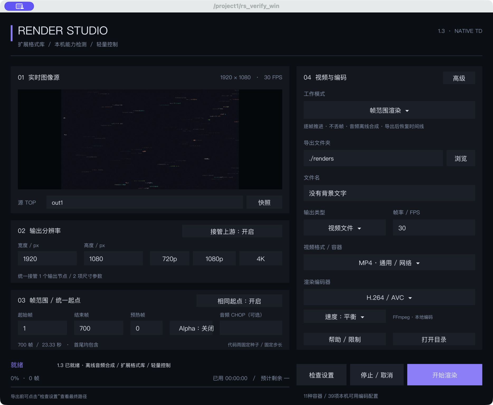

# Render Studio 1.3 — 离线逐帧音频合成与扩展格式库

## 使用入口

- **`工程/代码雨_RenderStudio_v1_3.toe`**：已接入新版的当前代码雨工程；原1.1和最佳版本备份保留。
- **`RenderStudio_1.3_TD2025.tox`**：独立插件，拖入其他工程使用。
- **`FORMAT_CATALOG.md`**：全部11种容器、39项编码/配置及兼容关系。
- **`TEST_REPORT.md`**：实际测试与性能口径，不是“所有环境无bug”保证。

## 本版新增

**离线逐帧音频合成：** 帧范围渲染现在可携带音轨。将含完整数据的非时间切片 CHOP 填入“音频 CHOP（可选）”，插件按帧范围与 FPS 计算样本区间，合成 16-bit WAV 后在成片阶段混入。样本边界按累计整数计算（offset=round(start×rate/fps)、count=round(N×rate/fps)），源短缺时尾部补静音，清单 manifest 记录 offset/samples/padded。已实测样本级对齐：脉冲定位误差为0。

**音频源约定：** 渲染模式要求**非时间切片** CHOP（Wave CHOP、Script CHOP 或经缓存录制的数据）。Audio File In CHOP 在本机 TD2025.31550 恒为时间切片（即使关闭 Time Slice 参数），不能直接使用，请先经 Wave/Script CHOP 或缓存转换。实时录制模式仍要求开启 Time Slice 的 CHOP，两种模式校验会明确拒绝不适配的源。

**格式库（1.2 已有）：** 11种容器：MP4、MOV、MKV、WebM、AVI、MXF、MPEG/MPG、MPEG-TS、FLV、WMV/ASF、GIF。39项编码/配置包含H.264/HEVC软件与VideoToolbox变体、AV1、VP8/VP9、6档ProRes、5档DNxHR、CineForm、Hap/Hap Q、Animation、JPEG2000、FFV1、HuffYUV、Ut Video、v210、RGB无压缩及传统兼容编码。39项包含档位和实现变体，不等于39种独立标准。EXR16高位深中间序列与音轨可共存（EXR不内嵌音频，成片阶段混入）。

菜单支持**搜索和分页**，复用8个条目控件，不为每项增加一套面板节点。先选容器，再选编码器；MOV/MKV通常有更多选项。输入搜索词后按Enter即可筛选。

## 快速导出

1. 最终TOP接入插件端口，或填入“源TOP”。同级节点填节点名即可，如`out1`；留空跟随端口。
2. 选择导出文件夹与文件名。默认`./renders`相对当前TOE工程目录；同名自动编号，不覆盖。
3. 设置宽高、帧范围和FPS。主面板有720p/1080p/4K预设。
4. 选择视频格式、编码器、速度档；点击检查，再开始。
5. 外部编码分为“采集画面”和“编码”两个阶段。停止/取消保留已经写入的数据或中间素材。

格式菜单依据兼容表筛选；内部`encoder_capabilities`表与高级页“重新检测本机编码器”提供依赖检查。检测到编码器不等于保证所有硬件/素材/参数组合成功，错误会显示在状态区。本机39项配置均有TD输出与实际解码样本，但未穷举全部交叉组合。

## 速度与精度怎么选

- **软件H.26x、AV1、VPx**可选快速/平衡/质量优先；不适用的编码器会禁用速度按钮。
- **H.264/HEVC VideoToolbox**提供本机硬件编码路径。它主要改善编码阶段，不会使复杂源网络自动变快。
- 默认中间精度为**自动**：普通8-bit外部输出使用无损MOV；高位深外部输出使用EXR16半浮点序列。
- “8-bit缓存（更快）”可减少磁盘压力，但不适合保留高位深源的细节；“EXR16”占空间、写盘更慢。
- 高位深缓存不等于HDR成片标准，不自动完成PQ/HLG、色域、显示变换或HDR元数据管理。HDR交付需另行核对。
- EXR16中间序列本身不内嵌音频，但离线合成会在成片阶段混入音轨，高位深与声音可共存。

**本机暖态空闲源同步平均0.012ms，最终完整UI更新平均0.394ms；这些是函数调用耗时，不是端到端延迟。** 引用轮询约100ms一次，完整视频渲染/编码不承诺毫秒完成。源效果、分辨率、帧数、磁盘和编码器仍决定总时长。

## 保留的统一控制

### 来源与分辨率
图像源、源内容、音频引用自动同步，无需拔插；暂停时也能处理引用变化。

“接管上游”只控制当前来源相关的输出链路和可识别公开尺寸参数。当前代码雨动态/静态输出一起跟随，原设置可恢复；关闭接管或换源会恢复旧节点。字形图集、材质纹理、UI和无关分支不盲改。删除插件前先释放接管。

### 相同起点
当前代码雨使用保存状态→固定起点/种子复位→固定步长推进→收尾恢复的适配。新版本两次48帧PNG仍逐帧像素一致，其中有42个不同画面。

第三方反馈、独立时钟、模拟器、摄像头/网络流不保证自动复现；可在“统一起点”页指定自己的Reset DAT，提供`onReset(exporter, reset_frame, fps)`，并确保源引擎能固定步长推进。

### 音频与透明
- 帧范围渲染支持**离线逐帧音频合成**：填入含完整数据的非时间切片 CHOP，按帧范围精确取样混入成片，样本级对齐已实测（详见本版新增与 TEST_REPORT.md）。
- 实时录制支持Time Slice的1/2声道CHOP；容器选择相应音频编码。WebM/Opus、MKV/FLAC已测试。
- MOV + ProRes4444/4444 XQ默认包含Alpha；其他支持Alpha的配置使用Alpha开关。
- 当前代码雨背景若Alpha为1，透明编码不会自动去背景。需要透明素材时先调整源。

## 依赖与恢复

本机使用已经安装的FFmpeg；未捆绑、安装或绕过TouchDesigner许可证。其他电脑可在高级页指定FFmpeg可执行文件。TD原生H.26x仍遵守许可证限制。

成功默认清理本任务中间文件；失败/取消会保留。编码已完成后再点取消，保留成片并显示完成，不谎称仍在取消。取消日志也参与文件重名检查，避免下一次媒体文件与旧任务日志混用。

仅在本机macOS / TD2025.31550验证。Windows、旧TD、完整广播规范、所有色彩/Alpha组合、磁盘写满与长时压力测试未覆盖。先用短样本核对复杂工程。

原SkyFeng署名、声明及停用归档保留（见 `原作者声明.txt`）；本版为基于停用版本的个人续作，不是SkyFeng官方版本。

## 验收与维护

- `TEST_REPORT.md`：通过项、旧证据复用、原生交互、性能口径和未覆盖范围。
- `TEST_SUMMARY.json`：39项实际编码样本及关键结果的结构化摘要。
- `CHANGELOG.md`：本版变更；`SHA256SUMS`：交付文件校验。
- `source/`：已嵌入插件的维护模块，正常导入不依赖此目录。

整合工程保留原代码雨设计与文件名；目录统一设为可迁移的`./renders`，相对于TOE所在目录。旧1.1、最佳版本备份和原始SkyFeng插件未覆盖。
