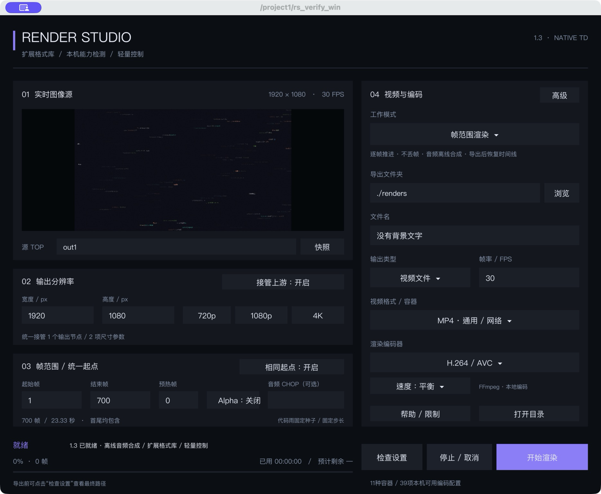
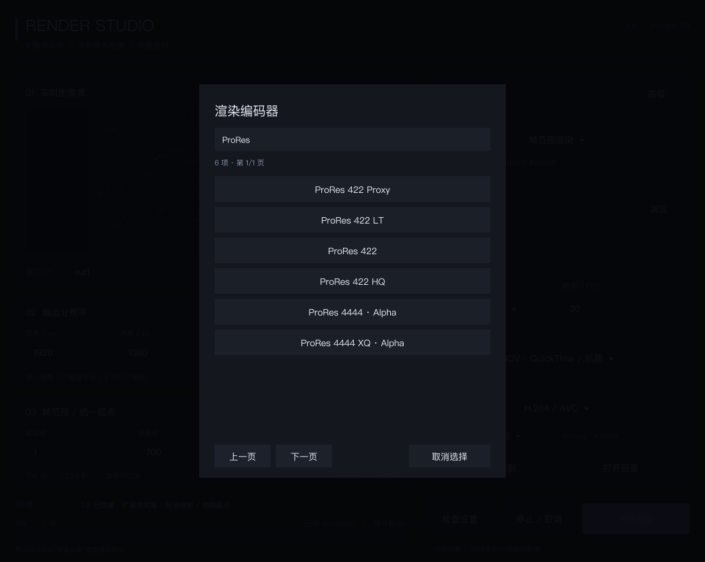

  <h1>RenderStudio</h1>
  
<strong>让 TouchDesigner 视觉工程，走向可控、可验证的成片交付。</strong>

  
原生 COMP 渲染／导出面板 · 离线逐帧音频合成 · 11 种容器 / 39 项编码配置

  

    <a href="README_EN.md"><strong>English</strong></a> ·
    <a href="README.md"><strong>中文</strong></a> ·
    <a href="https://github.com/luoboruodai/Touchdesigner-Renderstudio/releases/tag/v1.3.0"><strong>下载 v1.3.0</strong></a> ·
    <a href="PROMOTION.md">宣发文案</a>
  

  

    
    
    
    
  

  
   
  RenderStudio 1.3 的真实 TD 原生面板；不是网页概念图或合成演示。

> [!IMPORTANT]
> 当前仅在 **macOS / TouchDesigner 2025.31550** 完成验证。FFmpeg 由用户自行安装，本仓库不捆绑二进制。原声明限定**个人或非商业用途**；商业使用需联系 SkyFeng 获取授权，详见[原作者声明](原作者声明.txt)。

## 下载与安装

| 你的目标 | 应下载的附件 | 使用方式 |
|---|---|---|
| 在自己的 TD 工程中使用插件 | [`RenderStudio_1.3_TD2025.tox`](https://github.com/luoboruodai/Touchdesigner-Renderstudio/releases/download/v1.3.0/RenderStudio_1.3_TD2025.tox) | 拖入 TouchDesigner 工程 |
| 直接打开配套代码雨工程 | [`RenderStudio_1.3_TD2025_code-rain.toe`](https://github.com/luoboruodai/Touchdesigner-Renderstudio/releases/download/v1.3.0/RenderStudio_1.3_TD2025_code-rain.toe) | 用 TD 2025.31550 打开 |
| 核对发布文件 | [`SHA256SUMS`](https://github.com/luoboruodai/Touchdesigner-Renderstudio/releases/download/v1.3.0/SHA256SUMS) | 校验对应 Release 的成员与附件 |

GitHub 自动生成的 **Source code** 用于审查源码，不替代上述可安装附件。

### 环境准备

1. 安装 **TouchDesigner 2025.31550（macOS）**。
2. 安装 FFmpeg，并确保 `ffmpeg` 与 `ffprobe` 可用；其他路径可在插件高级页指定。
3. 下载 TOX 或 TOE，先用短样本验证自己的工程。

### 开始导出

1. 将最终 TOP 接入插件端口，或在「源 TOP」中填写节点；同级节点可直接填 `out1`，留空则跟随端口。
2. 选择输出目录与文件名。默认 `./renders` 相对当前 TOE，重名自动编号，不覆盖旧文件。
3. 设置宽高、帧范围与 FPS，选择容器、编码器和速度档。
4. 如需音轨，在「音频 CHOP（可选）」中填入符合下述约定的 CHOP。
5. 点击「检查设置」，确认后开始渲染或录制。

## 你能用它做什么

| 能力 | 当前实现 |
|---|---|
| 双模式导出 | 实时录制与帧范围渲染；摄像头、麦克风等实时输入仍走实时录制 |
| 离线逐帧音频合成 | 按帧范围与 FPS 累计整数样本边界取样，源不足时尾部补静音，成片阶段混入音轨 |
| 扩展格式库 | 11 种容器、39 项编码／档位／实现配置；39 项不等于 39 种独立编码标准 |
| 原生搜索与分页 | 容器与编码器分离，8 个条目控件复用，支持搜索、分页与本机能力重新检测 |
| 8-bit / EXR16 中间路径 | 普通输出可使用无损 MOV；高位深路径使用 EXR16，成片阶段仍可与音轨共存 |
| 可控的来源与尺寸 | 同步来源引用，接管相关输出尺寸；释放接管或删除组件时恢复已记录状态 |
| 相同起点适配 | 配套代码雨使用固定起点／种子与固定步长；第三方源可通过 Reset DAT 自行适配 |
| 取消与恢复 | 区分活动取消和已完成任务；保留取消／失败时的中间素材，成功时按约定清理 |

## 音频：少一步手工对轨

帧范围渲染不再只输出无声画面。插件按帧范围计算样本区间，生成 16-bit PCM WAV 中间文件，再在成片阶段混入音轨。

| 工作模式 | 音频源要求 |
|---|---|
| 帧范围渲染 | 含完整数据的**非时间切片** CHOP，例如 Wave CHOP、Script CHOP 或缓存录制结果 |
| 实时录制 | 开启 **Time Slice** 的音频 CHOP |

本机实测中，Audio File In CHOP 在 TD 2025.31550 恒为时间切片，不能直接作为离线渲染音频源，请先转换。离线合成不包含重采样、变速变调或多轨混音。

原生 MOV/ProRes 路径可直接复制视频流并混入 PCM；外部编码路径由 FFmpeg 合成。既有宿主测试中，原生 MOV/ProRes 的音频脉冲定位误差为 **0 个样本**。

## 格式与工作流

支持 MP4、MOV、MKV、WebM、AVI、MXF、MPEG/MPG、MPEG-TS、FLV、WMV/ASF、GIF，以及 H.264、HEVC、AV1、VP8/VP9、ProRes、DNxHR、CineForm、Hap、FFV1 等配置。

完整兼容关系、档位与精度说明见 **[格式目录](FORMAT_CATALOG.md)**。检测到编码器不代表所有硬件、素材和参数组合都已验证。

  
   
  原生编码器搜索与分页；不是逐项鼠标测试全部 39 项配置的声明。

## 验证与边界

| 证据层 | 已通过 | 范围说明 |
|---|---|---|
| TD 宿主执行 | 1.3 离线音频相关 **9/9** 用例 | 原生／外部路径、单帧、短缺补静音、EXR16、取消与双模式拒绝 |
| 纯规则 | **25/25** | 音频计划、合成、校验及既有命名／范围规则 |
| 实际解码 | 1.2 的 **39 项**编码配置样本 | 同源模块证据复用；1.3 未重新穷举，也不覆盖所有交叉组合 |
| 原生 UI | 真实鼠标搜索、分页、容器选择与面板检查 | 不代表所有菜单项均逐项鼠标测试 |
| 发布身份 | TOX／TOE 哈希、源码成员与下载字节回读 | 发布附件与 v1.3.0 标签分别核对 |

**未覆盖**：Windows、旧版 TD、长片压力、磁盘写满、所有分辨率／色彩／Alpha 交叉组合及完整广播交付规范。16-bit 缓存不自动完成 HDR 色彩或元数据管理。

详细口径见 **[测试报告](TEST_REPORT.md)**，结构化结果见 **[测试摘要](TEST_SUMMARY.json)**。

## 文档入口

- **[English README](README_EN.md)** — installation, workflow and validation boundaries
- **[格式目录](FORMAT_CATALOG.md)** — 容器、编码器、档位与兼容关系
- **[更新记录](CHANGELOG.md)** — 版本变化与文档更新
- **[测试报告](TEST_REPORT.md)** — 实测证据、性能口径与未覆盖项
- **[维护源码说明](source/README.md)** — 模块职责与维护入口
- **[原作者声明](原作者声明.txt)** — 署名、个人／非商业使用与商业授权边界
- **[宣发文案 / Launch Kit](PROMOTION.md)** — 可直接用于分享的中英文介绍

## 适合谁

- 需要把代码雨或其他 TD 视觉工程导出为交付视频的人。
- 需要在帧范围渲染中同步生成音轨、减少手工对轨的人。
- 需要在原生面板里管理格式、速度、精度、取消和恢复流程的人。

如果 RenderStudio 对你的工作流有帮助，欢迎 Star 或分享给使用 TouchDesigner 的创作者。反馈问题请附上 **TD build、操作系统、源类型、格式配置、短样本与可复现步骤**。

## 署名与使用边界

原插件为 **SkyFengStudio_MovieFileOut_2023X_RC**，作者 **SkyFeng Studio**。本版是基于停用版本的个人续作，**不是 SkyFeng 官方版本**。

原始署名、声明和停用归档保留。按原声明，仅限个人或非商业用途；商业使用需联系 SkyFeng 获取授权。本仓库的公开可见不代表新增宽泛许可，完整条款以 **[原作者声明](原作者声明.txt)** 为准。
