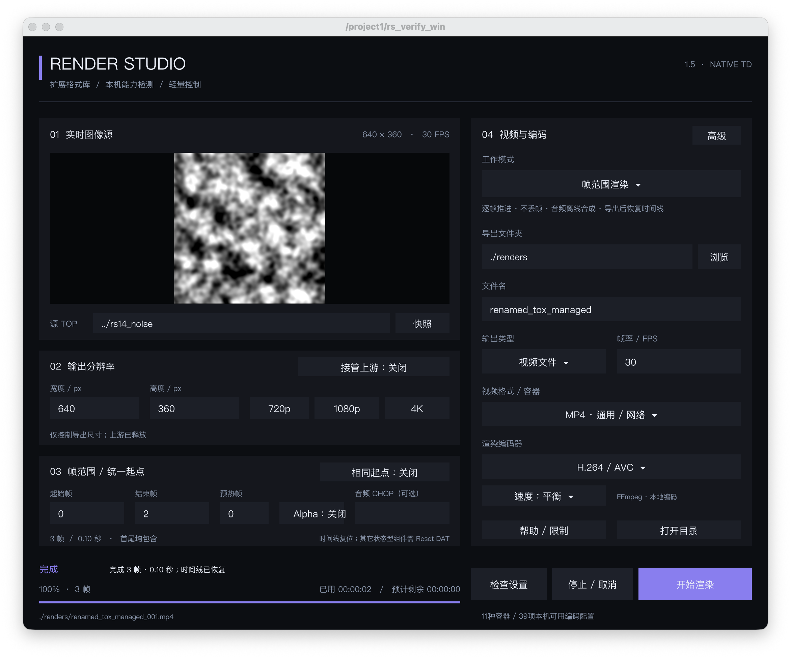

  <h1>RenderStudio</h1>
  
<strong>A new, original TouchDesigner export component that prepares your visuals, audio and encoding environment together.</strong>

  
Independent COMP plugin · Automatic FFmpeg setup on Windows and macOS · Offline frame-based audio

  

    <a href="README_EN.md"><strong>English</strong></a> ·
    <a href="README.md"><strong>中文</strong></a> ·
    <a href="https://github.com/luoboruodai/Touchdesigner-Renderstudio/releases/tag/v1.5.0"><strong>Download v1.5.0</strong></a> ·
    <a href="PROMOTION.md">Launch kit</a>
  

  

    
    
    
    
  

  
   
  The actual RenderStudio 1.5 TouchDesigner panel—not a web mockup or composite demo.

> [!IMPORTANT]
> This release contains **only the independent rendering component**; no code-rain project is bundled. On Windows x86_64 and macOS arm64 / amd64, the component downloads and configures **FFmpeg 9.0.2 + ffprobe** automatically when first required—no manual installation or administrator access. Original plugin code and the independent TOX are **MIT licensed**. Historical material and third-party projects are not relicensed.

## Download and install

| Goal | Release asset | How to use it |
|---|---|---|
| Add the component to your own TD project | [`RenderStudio_1.5_TD2025.tox`](https://github.com/luoboruodai/Touchdesigner-Renderstudio/releases/download/v1.5.0/RenderStudio_1.5_TD2025.tox) | Drag it into a TouchDesigner project |
| Verify published files | [`SHA256SUMS`](https://github.com/luoboruodai/Touchdesigner-Renderstudio/releases/download/v1.5.0/SHA256SUMS) | Check the corresponding Release members and assets |

GitHub's automatic **Source code** archives are for source review; they do not replace the installable assets above. **There is no code-rain TOE download.**

### Requirements

1. **TouchDesigner 2025.31550**.
2. **No manual FFmpeg installation.** On the first settings check or export that needs FFmpeg, the component downloads, verifies and configures it in the background. An existing usable installation is reused.
3. Download the TOX and validate your own project with a short sample first.

### Start an export

1. Connect the final TOP to the component input, or set its name in “Source TOP”. For a sibling node, a name such as `out1` is sufficient; leave it empty to follow the input.
2. Choose an output folder and filename. The default `./renders` path is relative to the current TOE. Existing files are not overwritten; new names are numbered automatically.
3. Set width, height, frame range and FPS, then choose a container, codec and speed preset.
4. To include audio, provide a CHOP that meets the mode-specific requirements below.
5. Run the settings check, then start rendering or recording.

## New in 1.5: automatic setup on Windows too

| Platform | Pinned distribution and validation |
|---|---|
| Windows x86_64 | BtbN `ffmpeg-n9.0.2-47-gb204e94e90-win64-gpl-9.0.zip`, exact byte count and SHA-256, PE x86_64 check, followed by version, encoder and real encode/decode tests on a Windows runner |
| macOS arm64 / amd64 | Martin Riedl 9.0.2 ZIPs, exact byte counts and SHA-256, Apple code-signature and system-dependency checks, plus real encode/decode tests |

- **On demand:** downloads only when the current workflow needs FFmpeg and no usable installation is found.
- **Background work:** shows progress and supports cancellation, then continues the original check or export action automatically.
- **Existing environments respected:** a valid manual path takes priority, followed by an existing system installation. No system PATH changes and no sudo.
- **Pinned supply chain:** immutable URLs, expected byte counts and SHA-256 hashes. Windows extraction is limited to `bin/ffmpeg.exe` and `bin/ffprobe.exe` from the pinned archive.
- **Recoverable failure:** failed verification or cancellation cleans up staging without creating an output movie or changing the timeline. Later runs reuse the verified installation.
- **Notices included:** the managed directory contains the GPLv3 text, build versions, exact upstream source and build-script links. FFmpeg is a separate executable with its own license, distinct from the plugin's MIT license.

Windows ARM64, other operating systems and older TD builds are outside the current automatic packages. Specify a system FFmpeg manually instead of treating those platforms as validated.

## Established rendering capabilities

| Capability | Current implementation |
|---|---|
| Two export modes | Real-time recording and frame-range rendering; live camera and microphone inputs remain in real-time recording |
| Offline frame-based audio | Calculates cumulative integer sample boundaries from frame range and FPS, pads missing source audio with silence, and mixes audio during final assembly |
| Extended format catalog | 11 containers and 39 codec, quality-tier and implementation configurations—not 39 independent codec standards |
| Native search and pagination | Separate container and codec controls, eight reused entry widgets, search, pagination and local capability redetection |
| 8-bit / EXR16 intermediate paths | Lossless MOV for ordinary external output; EXR16 for higher-precision workflows, with audio still added during final assembly |
| Controlled source and resolution | Follows source references and takes over related output dimensions, then restores recorded state when released or deleted |
| Repeatable-start adaptation | Supported sources can use a fixed start/seed and fixed-step progression; third-party sources can provide a Reset DAT |
| Cancellation and recovery | Distinguishes active cancellation from completed jobs, preserves intermediate material on cancellation/failure and cleans up on success as documented |

## Audio requirements

| Mode | Audio source requirement |
|---|---|
| Frame-range rendering | A **non-time-sliced** CHOP containing the complete data, such as a Wave CHOP, Script CHOP or cached recording |
| Real-time recording | An audio CHOP with **Time Slice** enabled |

On the tested TD 2025.31550 build, Audio File In CHOP remained time-sliced even when its Time Slice parameter was disabled. Convert or cache it before using it for offline rendering. Offline synthesis uses a 16-bit PCM WAV intermediate; resampling, time/pitch manipulation and multi-track mixing are not included.

## Validation and CI

- **36/36 pure-rule checks:** existing rendering rules plus the win64 manifest, bundle extraction, PE architecture, installation reuse, cancellation and failure cleanup.
- **Real macOS smoke:** download, installation, version/encoder verification, three-frame H.264+AAC encode/decode and second-run reuse all pass.
- **Independent TOX:** re-import under a different parent and a new name, relative source resolution and real three-frame decoding all pass.
- **Windows runner:** the `bootstrap-smoke` GitHub Actions workflow performs a real download, installation, version/encoder verification and three-frame encode/decode. See **Actions** for the exact commit and result.
- **Final artifact:** TOX modules are byte-identical to source, with no Legacy node and no test hooks.

Read the **[test report](TEST_REPORT.md)** and **[structured summary](TEST_SUMMARY.json)** for evidence. A successful Windows runner does not prove every physical Windows machine, GPU, older TD version or format combination has been validated.

## Documentation

- **[中文说明](README.md)**
- **[Format catalog](FORMAT_CATALOG.md)**
- **[Changelog](CHANGELOG.md)**
- **[Test report](TEST_REPORT.md)**
- **[MIT License](LICENSE)**
- **[Third-party notices](THIRD_PARTY_NOTICES.md)**
- **[Launch kit / 宣发文案](PROMOTION.md)**

## Originality and references

RenderStudio is a new, original export component. Its workflow references **SkyFengStudio_MovieFileOut_2023X_RC**, but it is neither an official SkyFeng release nor described as a continuation of that plugin. The independent TOX does not include `Legacy_2023_original`.

Original plugin source and the independent TOX use the **[MIT License](LICENSE)**, permitting free use, modification and redistribution, including commercial use. Third-party material in code-rain projects, historical versions or artwork remains under its respective licenses and is not covered by this MIT grant. The original declaration is retained only as reference and historical context.

If RenderStudio helps your workflow, a star or a share with another TouchDesigner creator is appreciated. For bug reports, include your **TD build, OS, source type, format configuration, a short sample and reproducible steps**.
