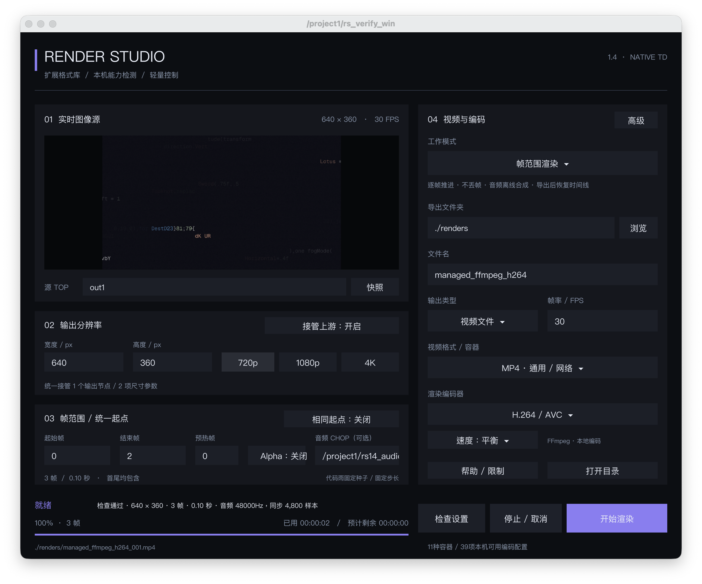
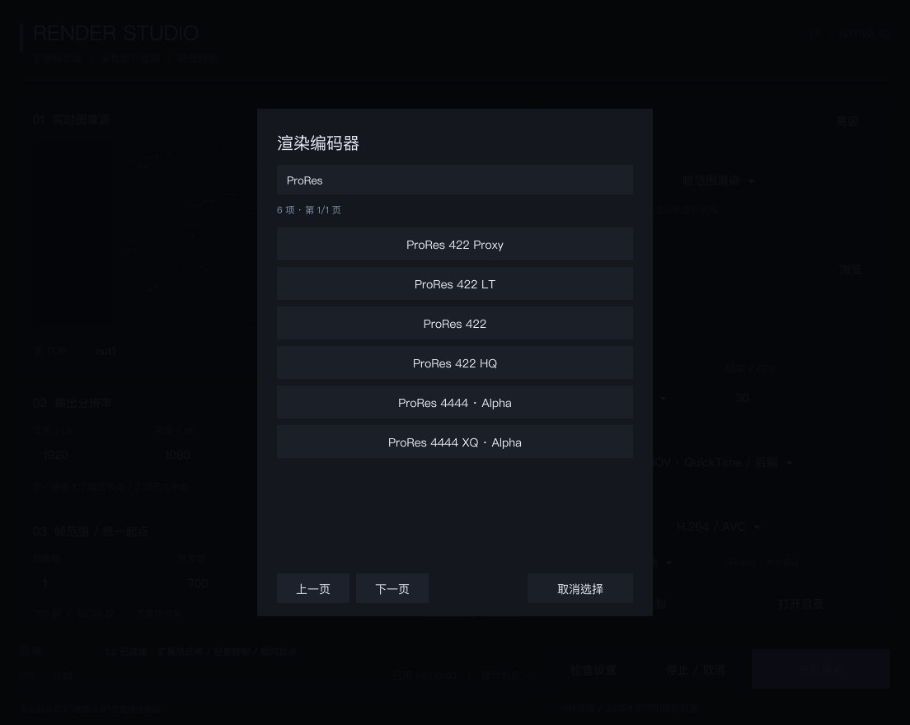

  <h1>RenderStudio</h1>
  
<strong>A new, original TouchDesigner export component that prepares your visuals, audio and encoding environment together.</strong>

  
Native COMP panel · Automatic FFmpeg setup · Offline frame-based audio · 11 containers / 39 codec configurations

  

    <a href="README_EN.md"><strong>English</strong></a> ·
    <a href="README.md"><strong>中文</strong></a> ·
    <a href="https://github.com/luoboruodai/Touchdesigner-Renderstudio/releases/tag/v1.4.0"><strong>Download v1.4.0</strong></a> ·
    <a href="PROMOTION.md">Launch kit</a>
  

  

    
    
    
    
  

  
   
  The actual RenderStudio 1.4 TouchDesigner panel—not a web mockup or composite demo.

> [!IMPORTANT]
> Validation currently covers **macOS / TouchDesigner 2025.31550**. When FFmpeg is first required, the component downloads and configures **FFmpeg 9.0.2 + ffprobe** automatically—no manual installation or administrator access. Original plugin code and the independent TOX are **MIT licensed**. Companion artwork, historical material and third-party projects are not relicensed; see the [third-party notices](THIRD_PARTY_NOTICES.md).

## Download and install

| Your goal | Release asset | How to use it |
|---|---|---|
| Add the component to your own TD project | [`RenderStudio_1.4_TD2025.tox`](https://github.com/luoboruodai/Touchdesigner-Renderstudio/releases/download/v1.4.0/RenderStudio_1.4_TD2025.tox) | Drag it into a TouchDesigner project |
| Open the companion code-rain project | [`RenderStudio_1.4_TD2025_code-rain.toe`](https://github.com/luoboruodai/Touchdesigner-Renderstudio/releases/download/v1.4.0/RenderStudio_1.4_TD2025_code-rain.toe) | Open it with TD 2025.31550 |
| Verify published files | [`SHA256SUMS`](https://github.com/luoboruodai/Touchdesigner-Renderstudio/releases/download/v1.4.0/SHA256SUMS) | Check the corresponding Release members and assets |

GitHub's automatic **Source code** archives are for source review; they do not replace the installable assets above.

### Requirements

1. **TouchDesigner 2025.31550 on macOS**.
2. **No manual FFmpeg installation.** On the first settings check or export that needs FFmpeg, the component downloads, verifies and configures it in the background. An existing usable installation is reused.
3. Download the TOX or TOE and validate your own project with a short sample first.

### Start an export

1. Connect the final TOP to the component input, or set its name in “Source TOP”. For a sibling node, a name such as `out1` is sufficient; leave it empty to follow the input.
2. Choose an output folder and filename. The default `./renders` path is relative to the current TOE. Existing files are not overwritten; new names are numbered automatically.
3. Set width, height, frame range and FPS, then choose a container, codec and speed preset.
4. To include audio, provide a CHOP that meets the mode-specific requirements below.
5. Run the settings check, then start rendering or recording.

## New in 1.4: automatic FFmpeg setup

- **On demand:** downloads only when the current workflow needs FFmpeg and no usable installation is found; it does not replace an existing environment.
- **Background work:** shows progress and supports cancellation, then continues the original check or export action automatically.
- **Manual paths respected:** a valid path on the advanced page takes priority. Invalid paths produce a clear error; automatic discovery and setup apply only when the field is empty.
- **Pinned supply chain:** separate macOS arm64 and amd64 ZIPs use exact byte counts and SHA-256 hashes. Apple code signatures, system-only dynamic dependencies and all 31 required video/audio encoders are verified.
- **Private installation:** files stay in the current user's RenderStudio directory. No system PATH changes, no sudo and no FFmpeg binaries embedded in the TOX.
- **Recoverable failure:** failed verification or cancellation cleans up staging without creating an output movie or changing the timeline. Later runs reuse the verified installation.
- **Notices included:** the managed directory contains the GPLv3 text, build versions, exact upstream source and build-script links. FFmpeg is a separate executable with its own license, distinct from the plugin's MIT license.

## Established rendering capabilities

| Capability | Current implementation |
|---|---|
| Two export modes | Real-time recording and frame-range rendering; live camera and microphone inputs remain in real-time recording |
| Offline frame-based audio | Calculates cumulative integer sample boundaries from frame range and FPS, pads missing source audio with silence, and mixes audio during final assembly |
| Extended format catalog | 11 containers and 39 codec, quality-tier and implementation configurations—not 39 independent codec standards |
| Native search and pagination | Separate container and codec controls, eight reused entry widgets, search, pagination and local capability redetection |
| 8-bit / EXR16 intermediate paths | Lossless MOV for ordinary external output; EXR16 for higher-precision workflows, with audio still added during final assembly |
| Controlled source and resolution | Follows source references and takes over related output dimensions, then restores recorded state when released or deleted |
| Repeatable-start adaptation | The companion code-rain project uses a fixed start/seed and fixed-step progression; third-party sources can provide a Reset DAT |
| Cancellation and recovery | Distinguishes active cancellation from completed jobs, preserves intermediate material on cancellation/failure and cleans up on success as documented |

## Audio requirements

| Mode | Audio source requirement |
|---|---|
| Frame-range rendering | A **non-time-sliced** CHOP containing the complete data, such as a Wave CHOP, Script CHOP or cached recording |
| Real-time recording | An audio CHOP with **Time Slice** enabled |

On the tested TD 2025.31550 build, Audio File In CHOP remained time-sliced even when its Time Slice parameter was disabled. Convert or cache it before using it for offline rendering. Offline synthesis uses a 16-bit PCM WAV intermediate; resampling, time/pitch manipulation and multi-track mixing are not included.

The native MOV/ProRes path can copy the video stream while adding PCM; external paths use FFmpeg. In the existing 1.3 native MOV/ProRes host test, the decoded audio impulse landed at the expected sample with **zero-sample offset**.

## Formats and workflow

The catalog covers MP4, MOV, MKV, WebM, AVI, MXF, MPEG/MPG, MPEG-TS, FLV, WMV/ASF and GIF, with configurations for H.264, HEVC, AV1, VP8/VP9, ProRes, DNxHR, CineForm, Hap, FFV1 and more.

See the **[format catalog](FORMAT_CATALOG.md)** for compatibility, quality tiers and precision details. Detecting a codec does not mean every hardware, source and parameter combination has been validated.

  

## Validation and boundaries

- **31/31 pure-rule checks:** existing naming, range and audio rules plus manifest pinning, installation reuse, failure cleanup, cancellation, ZIP member and protocol allowlists.
- **Real downloads:** both macOS architecture packages passed SHA-256, code-signature and dependency checks, followed by an actual H.264+AAC encode and ffprobe decode.
- **Existing host evidence:** 9/9 offline-audio cases from 1.3; the 39 codec configuration samples from 1.2 are reused for the same source modules.
- **New 1.4 acceptance:** automatic setup, real export through the managed path, second-run reuse and final TOX/TOE identity are documented in the [test report](TEST_REPORT.md) and structured results.

**Not covered:** Windows, older TD versions, long-form stress tests, a full disk, every resolution/color/alpha combination, or complete broadcast-delivery certification. Automatic downloads currently provide macOS arm64 and amd64 packages only; other architectures and platforms require separate validation.

## Documentation

- **[中文说明](README.md)**
- **[Format catalog](FORMAT_CATALOG.md)**
- **[Changelog](CHANGELOG.md)**
- **[Test report](TEST_REPORT.md)**
- **[MIT License](LICENSE)**
- **[Third-party notices](THIRD_PARTY_NOTICES.md)**
- **[Launch kit / 宣发文案](PROMOTION.md)**

## Originality and references

RenderStudio is a new, original export component. Its workflow references **SkyFengStudio_MovieFileOut_2023X_RC**, but it is neither an official SkyFeng release nor described as a continuation of that plugin. The independent 1.4 TOX does not include `Legacy_2023_original`.

Original plugin source and the independent TOX use the **[MIT License](LICENSE)**, permitting free use, modification and redistribution, including commercial use. Third-party material in the companion code-rain project, historical versions or artwork remains under its respective licenses and is not covered by this MIT grant. The original declaration is retained only as reference and historical context.

If RenderStudio helps your workflow, a star or a share with another TouchDesigner creator is appreciated. For bug reports, include your **TD build, OS, source type, format configuration, a short sample and reproducible steps**.
